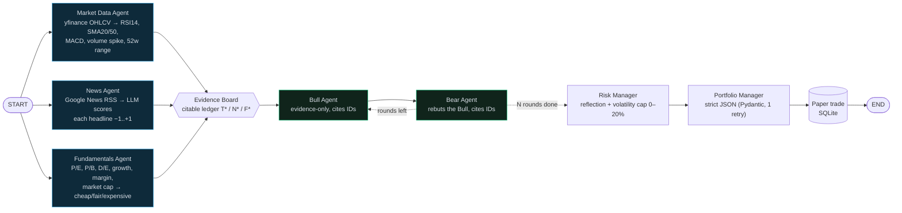
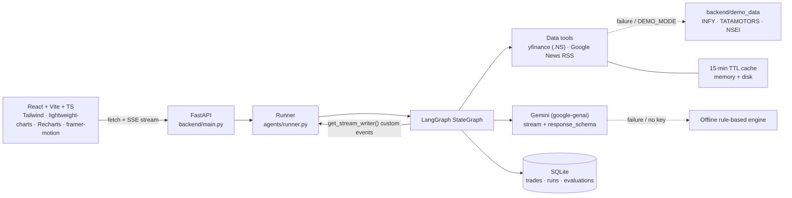

# QUORUM — AI Trading Floor

> **Agents debate, then reach a group decision.** QUORUM is a multi-agent stock research assistant for Indian (NSE) stocks. Type a ticker and seven AI agents analyse it live on a Bloomberg-style "trading floor". The Bull and Bear argue over the evidence, a Risk Manager audits their arguments, and a Portfolio Manager decides **BUY / HOLD / SELL** and places a paper trade in a virtual ₹1,00,000 portfolio.

> [!WARNING]
> **Educational simulation, not financial advice.** QUORUM is a college mini-project for a Generative AI & Agentic AI course. Its decisions come from language models and simple rules applied to public data. It trades a *virtual* portfolio only and must never be used for real investment decisions.

---

## Contents

1. [What it does](#what-it-does)
2. [Screenshots](#screenshots)
3. [Agentic AI concepts demonstrated](#agentic-ai-concepts-demonstrated)
4. [Architecture](#architecture)
5. [Setup](#setup)
6. [Using it](#using-it)
7. [Evaluation methodology](#evaluation-methodology)
8. [Project structure](#project-structure)
9. [API](#api)
10. [Limitations](#limitations)
11. [Troubleshooting](#troubleshooting)

---

## What it does

| Page | What you see |
| --- | --- |
| **Trading Floor** | Ticker search (autocomplete over ~55 popular NSE stocks), a 6-month candlestick chart with SMA20/SMA50 and volume, and one live card per agent (idle → thinking (pulsing) → done). The three analyst cards pulse **at the same time** because they run in parallel. The debate floor shows Bull bubbles on the left and Bear on the right, streamed round by round, with clickable evidence citations and yellow Risk Manager callouts. The verdict shows a large animated BUY/HOLD/SELL badge, a confidence ring, position size, three rationale bullets and the paper-trade ticket. A collapsible **Agent Trace** shows the LangGraph topology lighting up node by node, a timing chart that makes the parallelism visible, and every raw tool call. |
| **Portfolio** | Cash, holdings, total value, P&L, trade history, recent decisions (agent memory), and a line chart of the portfolio vs the **Nifty 50 (^NSEI)**, both normalised to 100. |
| **Evaluation** | One click evaluates 10 tickers: agent decisions vs **buy & hold**, an **RSI rule** (buy < 30, sell > 70) and **random**, scored on forward returns over N trading days. Only dates **after `LLM_KNOWLEDGE_CUTOFF`** are allowed, and the page explains why. |

Every agent's reasoning is **streamed token by token over Server-Sent Events**, so nothing happens off-screen.

## Screenshots

> _Add your screenshots here before submission._

| Trading Floor | Debate & Verdict | Portfolio | Evaluation |
| --- | --- | --- | --- |
| `docs/screenshots/floor.png` | `docs/screenshots/debate.png` | `docs/screenshots/portfolio.png` | `docs/screenshots/evaluation.png` |

## Agentic AI concepts demonstrated

| Concept | Where it lives | What to show in the viva |
| --- | --- | --- |
| **Multi-agent orchestration** | `backend/agents/graph.py`: a LangGraph `StateGraph` over a typed shared state (`state.py`) | Open **Agent Trace** to watch nodes light up. Seven agents, nine graph nodes. |
| **Tool use** | `analysts.py` calls `yfinance.history`, `compute_indicators`, `google_news_rss`, `yfinance.info`; the PM calls `portfolio.read_state_and_memory` and `paper_broker.execute` | Every call (args, result, timing) is listed under "Raw tool calls". |
| **Parallel execution** | Fan-out `START → {market, news, fundamentals}` and fan-in to `evidence_board` | The three analyst cards pulse together, and their bars overlap in the timing chart. |
| **Debate** | `debate.py`: Bull ⇄ Bear loop via a **conditional edge** (`after_bear`) for N rounds. Each turn answers the opponent's last argument. | Debate floor, round dividers. |
| **Grounding / citations** | `evidence.py` builds a ledger of citable facts (`T1…` technical, `N0…` news, `F1…` fundamentals). Debaters must cite IDs, which are parsed and validated. | Hover a citation chip to see the evidence. Invalid IDs show red and struck through. |
| **Reflection** | `risk.py`: deterministic checks (no citations, made-up IDs, figures absent from the ledger, evidence that contradicts the claim) **plus** an LLM review of argument quality | Yellow callouts attached to the exact turn they criticise. |
| **Structured output** | `schemas.py`: Pydantic models passed to Gemini as `response_schema`, then validated. Invalid JSON is **retried once** with the validation error fed back (`llm/client.py`). | The notice "Output failed Pydantic validation … retrying once". `python -m backend.selftest` exercises this path. |
| **Guardrails / business rules** | Volatility-scaled position cap (0–20%), clamping after validation, no short selling | Risk card shows σ → cap, and the verdict shows any adjustment. |
| **Memory / persistence** | SQLite via SQLModel (`db.py`): trades, every analysis run, evaluations. The PM is shown its last 3 decisions on the ticker. | Portfolio → "Recent decisions (agent memory)". |
| **Evaluation** | `services/evaluation.py`: baselines, forward returns, look-ahead guard, a random-strategy noise band | Evaluation page. |
| **Resilience** | 15-minute TTL cache, LLM timeout plus one retry, circuit breaker, offline rule-based engine, `DEMO_MODE` cached data | Unplug the network or remove the key: the demo keeps working, and outputs are labelled *Offline engine*. |

## Architecture

### LangGraph flow



The graph is compiled from code. `GET /api/graph` returns LangGraph's own `draw_mermaid()` output, which is also shown in the Agent Trace panel.

### System



### Event stream

`GET /api/analyze/{ticker}/stream` emits one SSE `data:` frame per event:

| `type` | Payload |
| --- | --- |
| `run_start` | ticker, company, price, data source, LLM status, rounds |
| `node` | LangGraph node `start` / `end` with timing (powers the trace timeline) |
| `agent_status` | `thinking` / `waiting` / `done` / `error` / `skipped`, and the LLM source |
| `tool_call` | tool name, args, result summary, ms |
| `token` / `token_reset` | streamed text chunks per agent (and per debate turn) |
| `agent_data` / `agent_output` | intermediate and final structured outputs |
| `debate_turn_start` / `debate_turn_end` | one per argument, with parsed and validated citations |
| `verdict`, `trade` | final decision and paper-trade result |
| `notice`, `error`, `done` | user-facing messages (toasts) and completion |

## Setup

**Prerequisites:** Python **3.11+**, Node.js **20.19+ / 22.12+** (for Vite 8), and optionally a Google Gemini API key ([get one here](https://aistudio.google.com/apikey)).

### Quick start

```bash
git clone https://github.com/aryanpol73/quorum.git
cd quorum
```

macOS / Linux / Git Bash:

```bash
./run.sh
```

Windows (cmd or PowerShell):

```bat
run.bat
```

On the first run the script copies `.env.example` to `.env`, creates `.venv`, installs `backend/requirements.txt` and the npm packages, then starts the backend at <http://localhost:8000> and the frontend at **<http://localhost:5173>**.

Add your key to `.env` to switch from the offline engine to Gemini:

```ini
GEMINI_API_KEY=your-key-here
GEMINI_MODEL=gemini-flash-latest
```

### Manual setup

```bash
python -m venv .venv
source .venv/bin/activate          # Windows: .venv\Scripts\activate
pip install -r backend/requirements.txt
cp .env.example .env               # Windows: copy .env.example .env
uvicorn backend.main:app --port 8000
```

```bash
cd frontend
npm install
npm run dev
```

Run everything from the **repository root**. The backend is a Python package (`backend.*`).

### Configuration (`.env`)

| Variable | Default | Purpose |
| --- | --- | --- |
| `GEMINI_API_KEY` | empty | Gemini key. Empty means the offline engine. |
| `GEMINI_MODEL` | `gemini-flash-latest` | Any Gemini model id. |
| `GEMINI_THINKING_LEVEL` | empty | Optional `minimal`/`low`/`medium`/`high` (Gemini 3+). |
| `LLM_TEMPERATURE` / `LLM_TIMEOUT_SECONDS` | `0.2` / `45` | Low temperature, per-call timeout (plus one retry). |
| `LLM_KNOWLEDGE_CUTOFF` | `2026-06-30` | Evaluation only allows dates **after** this. |
| `DEMO_MODE` | `false` | Use cached INFY / TATAMOTORS data. |
| `DEBATE_ROUNDS` | `3` | Bull/Bear rounds on the Trading Floor. |
| `CACHE_TTL_SECONDS` | `900` | yfinance and news cache (15 min). |
| `EVAL_TICKERS` / `EVAL_DEBATE_ROUNDS` / `EVAL_HOLD_BAND` | 10 large caps / `1` / `0.02` | Evaluation settings. |

## Using it

### CLI (verifies the whole pipeline without the frontend)

```bash
python -m backend.cli INFY
```

This prints every event: parallel node starts, tool calls with results, the streamed debate, risk flags, the verdict, the paper trade and the final node order with timings. Options:

| Flag | Effect |
| --- | --- |
| `--rounds 2` | Number of debate rounds |
| `--no-trade` | Skip the paper trade |
| `--demo` | Force cached demo data |
| `--offline` | Ignore the API key and use the offline engine |
| `--as-of 2026-09-15` | Historical analysis (no trade) |
| `--json` | Raw JSON-lines event stream |

### Self-test (no network, no key)

```bash
python -m backend.selftest
```

This runs the offline pipeline. It also drives the **Gemini code path against a scripted fake model**, covering token streaming, schema-constrained JSON, the invalid-JSON → retry-once path and clamping. Finally it checks the evaluation maths and the look-ahead guard.

### Demo mode

Set `DEMO_MODE=true` (or pass `--demo` to the CLI) to serve **INFY** and **TATAMOTORS** from `backend/demo_data/` (2 years of OHLCV, 10 headlines, fundamentals, plus Nifty 50 history). The same files are used automatically if Yahoo Finance or Google News fails, and the offline engine takes over if Gemini fails. **The demo never breaks.** To refresh the snapshot, run:

```bash
python -m backend.scripts.build_demo_data
```

## Evaluation methodology

* **Look-ahead bias guard.** An LLM may "remember" what happened after a date that falls before its training cutoff. Evaluation dates must therefore be after `LLM_KNOWLEDGE_CUTOFF`, and the API refuses earlier dates.
* **Point-in-time inputs.** Prices and indicators are truncated at the as-of date. News uses Google News `after:` / `before:` operators and drops anything published later. Fundamentals are a *current* snapshot, so they are **excluded by default** (strict mode).
* **Forward return** = close at as-of + N trading days ÷ close at as-of − 1.
* **Hit:** BUY if the return > 0, SELL if < 0, HOLD if within ±`EVAL_HOLD_BAND`. **Strategy return:** BUY = +r, SELL = −r (short), HOLD = 0.
* **Baselines:** buy & hold, an RSI(14) rule (< 30 buy, > 70 sell, else hold), and random (expected value over 2,000 seeded simulations, with a 5th–95th percentile band).

> **Expect near-random results.** Ten decisions over one short window are dominated by noise; the random band alone usually spans 20–70% hit rate. QUORUM's value is **explainability**: cited evidence, a visible debate and a risk review behind every call. It is **not prediction**. The Evaluation page states this next to the numbers.

## Project structure

```
quorum/
├── backend/
│   ├── main.py                 FastAPI app, SSE endpoints
│   ├── cli.py                  python -m backend.cli INFY
│   ├── selftest.py             offline + fake-Gemini self-tests
│   ├── config.py  cache.py  db.py  tickers.py
│   ├── agents/
│   │   ├── graph.py            LangGraph StateGraph (fan-out, fan-in, debate loop)
│   │   ├── state.py            typed shared state with reducers
│   │   ├── analysts.py         Market Data, News, Fundamentals agents (tool-using)
│   │   ├── evidence.py         citable evidence ledger + citation parser
│   │   ├── debate.py           evidence board, Bull, Bear, loop condition
│   │   ├── risk.py             reflection checks + volatility position cap
│   │   ├── portfolio_manager.py final decision + paper-trade node
│   │   ├── prompts.py  schemas.py  common.py  runner.py
│   ├── llm/
│   │   ├── client.py           Gemini: streaming, strict JSON, timeout, retry, circuit breaker
│   │   └── fallback.py         offline rule-based engine (same schemas)
│   ├── data/                   market.py (yfinance + indicators), news.py (RSS), fundamentals.py
│   ├── services/               portfolio.py (paper broker), evaluation.py
│   ├── demo_data/              INFY, TATAMOTORS, NSEI snapshots
│   ├── scripts/build_demo_data.py
│   └── requirements.txt
├── frontend/                   React 19 + Vite 8 + TypeScript + Tailwind 4
│   └── src/
│       ├── pages/              TradingFloor, Portfolio, Evaluation
│       ├── components/         AgentCards, DebatePanel, VerdictPanel, AgentTrace, PriceChart, …
│       └── lib/                SSE client, run-state reducer, formatting
├── .env.example  run.sh  run.bat
```

## API

| Method | Path | |
| --- | --- | --- |
| GET | `/api/health` | LLM status, demo mode, cutoff |
| GET | `/api/tickers` | popular NSE list |
| GET | `/api/chart/{ticker}` | 6M OHLCV + SMA20/50 + indicators |
| GET | `/api/analyze/{ticker}/stream?rounds=3` | **SSE** agent run |
| GET | `/api/graph` | LangGraph nodes, edges, Mermaid |
| GET | `/api/portfolio` · `/api/portfolio/history` · `/api/trades` · `/api/runs` | portfolio state |
| POST | `/api/portfolio/reset` | delete all paper trades |
| GET | `/api/evaluation/config` · `/api/evaluation/latest` | evaluation settings, last results |
| GET | `/api/evaluation/stream?as_of=YYYY-MM-DD&horizon=10` | **SSE** evaluation run |

Interactive docs are available at <http://localhost:8000/docs>.

## Limitations

* **Not predictive.** Expect near-random accuracy, as explained above. Never trade real money on it.
* **Data quality.** yfinance is an unofficial Yahoo Finance client: it can rate-limit, lag or miss fields (e.g. bank D/E). Raw closes are used, so dividends are ignored in returns.
* **News** is limited to roughly 10 Google News headlines per run. Headline-level sentiment ignores article bodies, and some headlines are market-wide rather than company-specific.
* **Fundamentals** are a current snapshot, not point-in-time, so they are excluded from strict evaluation.
* **Small evaluation sample.** One as-of date × 10 tickers is noisy. The UI shows the random-strategy band for scale.
* **Paper trading** is simplified: fills at the latest close, no brokerage, slippage or taxes, no short selling, and BUY sizes rebalance up to a target weight.
* **Offline engine.** Keyword sentiment and rule-based debate templates are far weaker than an LLM. They exist so the demo never breaks, and the UI always labels them.
* **LLM risks.** Models can still misread evidence. Citation checks and the reflection step reduce but do not eliminate this.

## Troubleshooting

* **Windows "The filename or extension is too long" / DLL load failed.** Keep the repo in a short path (e.g. `C:\dev\quorum`). Some compiled wheels (SQLAlchemy, curl_cffi) fail to load when the full path exceeds 260 characters.
* **TATAMOTORS.** After the Oct 2025 demerger, Yahoo no longer serves `TATAMOTORS.NS`, so QUORUM maps `TATAMOTORS` to `TMPV.NS` (Tata Motors Passenger Vehicles).
* **Gemini model errors.** Google retires model ids regularly. If you see 404s, set `GEMINI_MODEL` to a current id from <https://ai.google.dev/gemini-api/docs/models>. A rejected key disables Gemini for the session, and the offline engine takes over.
* **Yahoo rate limits.** Results are cached for 15 minutes. Set `DEMO_MODE=true` for presentations.

---

**Disclaimer:** QUORUM is an educational simulation built for coursework. It does not provide investment, financial, legal or tax advice. Market data may be delayed or inaccurate, and all trades are virtual.
